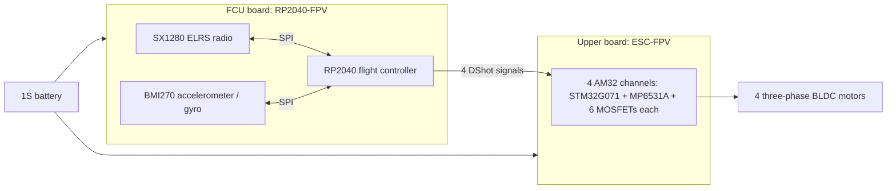

# OpenMicroQuad 1S

An experimental, custom-designed micro-quadcopter built around two stacked PCBs: a flight controller (FCU) with an integrated ExpressLRS (ELRS) radio transceiver and Bosch inertial sensor, and an AM32-based 4-in-1 electronic speed controller (ESC) that plugs onto the FCU from above. Both PCBs were designed in Altium Designer for a single-cell LiPo/LiHV battery.

This repository documents the **1S design**, including its hardware files and limitations.

## Hardware overview

| Subsystem | Implementation |
| --- | --- |
| Flight controller | RP2040 with external W25Q16 QSPI flash |
| Radio | Semtech SX1280IMLTRT transceiver for the 2.4 GHz ELRS link, connected to the RP2040 over SPI; U.FL antenna connector |
| Inertial sensor | Bosch BMI270 accelerometer and gyroscope, connected to the RP2040 over a separate SPI bus |
| ESC | Four independent AM32-based channels, each with an STM32G071GBU6 and MP6531A gate driver |
| Power stage | 24 CSD15571Q2 N-channel MOSFETs, forming three half-bridges per motor |
| Supply | 1S LiPo/LiHV; ESC TPS61023 boost regulator for the 5 V driver supply and MIC5323 LDO for 3.3 V logic |
| Motors | 1S, ~22,000 KV Air75-class motors |
| Construction | ESC plugged onto the FCU through four six-pin headers, with a 3D-printed frame |

## Two-board architecture

The **FCU board (`RP2040-FPV`)** handles flight control, radio communication, and motion sensing. The SX1280 radio and BMI270 sensor connect directly to the RP2040 over separate SPI buses. The board also includes USB-C, battery-voltage sensing, an RGB status LED, BOOTSEL/reset/user buttons, and an SWD debugging connector.

The **upper ESC board (`ESC-FPV`)** drives four three-phase brushless motors. Its hierarchical schematic repeats `MotorDriverChannel.SchDoc` four times. Each channel has its own STM32 running AM32, an MP6531A gate driver, six MOSFETs, and back-EMF sensing. The FCU sends one DShot signal to each channel; each motor has a separate three-pin phase connector.

The boards share **VBAT and GND**, while their regulated supplies remain separate. The FCU selects battery or USB power and generates its own 3.3 V supply. The ESC boosts battery voltage to 5 V for its gate drivers, then regulates that to 3.3 V for its MCUs; the motor bridges run directly from VBAT. With only USB connected, the FCU is powered and the ESC is off, so FCU firmware must avoid driving DShot into the unpowered ESC. UART, I2C, and an ADC signal are also brought to the stack headers but are currently unused on the ESC.

## Design files

| Board | Altium project | Schematic and PCB PDF | Additional outputs |
| --- | --- | --- | --- |
| FCU | [RP2040-FPV.PrjPcb][fcu-project] | [RP2040-FPV.pdf][fcu-pdf] | No separate manufacturing archive or BOM included |
| ESC | [ESC-FPV.PrjPcb][esc-project] | [ESC-FPV.pdf][esc-pdf] | [Project Outputs for ESC-FPV.zip][esc-outputs]: Gerber X2 files, drill layers/reports, CSV BOM, pick-and-place CSV, and archived DRC reports |

The FCU project is organized as follows:

| File | Purpose |
| --- | --- |
| `MCU.SchDoc` | RP2040, QSPI flash, clock, and signal assignments |
| `RF.SchDoc` | SX1280 radio, oscillator, RF matching/filter network, and antenna connection |
| `Interfacing.SchDoc` | BMI270, stack headers, debug connector, buttons, RGB LED, and battery sensing |
| `Power.SchDoc` | Battery/USB power selection, USB-C interface, and 3.3 V regulation |
| `PCB.PcbDoc` | FCU board layout |

The ESC project is organized as follows:

| File | Purpose |
| --- | --- |
| `Main.SchDoc` | Top-level hierarchy joining four motor-driver channels, power, and interfacing |
| `MotorDriverChannel.SchDoc` | Reusable single-motor controller, gate driver, MOSFET bridge, and back-EMF sensing |
| `Power.SchDoc` | Battery input, 5 V boost converter, and 3.3 V regulation |
| `Interfacing.SchDoc` | FCU stack headers, per-channel SWD programming test points, and repeated motor connections |
| `MotorConnection.SchDoc` | Three-phase connector, repeated once per motor |
| `PCB.PcbDoc` | Combined four-channel ESC board layout |

## Firmware

- Adapted Betaflight firmware: TBA
- Adapted AM32 firmware: TBA

### Flashing, Configuration, and Setup

TBA

## Measurements

TBA

We can typically see 64W total power draw at full throttle at 4V battery voltage, which is about 16W (4A) per motor. Our ESC is designed to handle 8A continuously and can probably easily handle 10-15A per channel, so we have plenty of headroom. PCB temperature (stationary, no airflow) is about 35°C at full throttle, and the MOSFET peak at about 45°C. In flight, due to much stronger airflow and thus convective cooling, we expect the PCB and MOSFETs to run even cooler. No issues here.

## Limitations

Some limitations of this design are inherent to the 1S architecture, while others are due to the choice of components and the two-board design:

### Limited thrust

We went with two separate PCBs because we wanted to build and test the FCU first, then tackle the ESC and test that on its own. Another very important reason was that we also wanted all the tricky-to-solder parts, like QFN and BGA packages, on just one side of each board. A single 5-in-1 PCB with components on both sides would've made that much less practical to assemble and solder by hand.

The tradeoff is more PCB mass and board space than you'd normally see on a tinywhoop, plus a heavier frame. The small 22,000 KV motors and 1S batteries are yoinked from an Air75, where they have a lot less weight to carry. They're a bit underpowered for our setup. The drone still shreds, but it's more sluggish, and battery capacity and flight time are somewhat limited. More powerful motors could help with the thrust while still using 1S batteries, but they'd need a lot of current.

### FCU performance

A goal of this project was to simply test how well an RP2040 would perform in a drone application (and add support to Betaflight). The RP2040 offers less processing headroom for demanding flight-control configurations than more powerful MCUs, and it has no built-in floating-point unit. The RP2040 is still a very capable MCU, but it may not be the best choice for a high-performance flight controller. We can easily fly drones in acro mode with 1.6kHz PID loops, but we may run into performance issues with more complex flight-control algorithms, higher loop rates, or when also using the accelerometer (e.g., when using angle or horizon modes). 3.2kHz PID loops are out of the question. The RP2350 already has Betaflight firmware support, and it would be interesting to see how well it performs in a similar drone application.

### Are we FPV yet?

Hell nah - No camera, OSD, and VTX yet. We may want to add a small camera and VTX in the future - either as a separate module or integrated into the main FCU PCB. For now, we're limited to LoS flight :)

### Future Directions

There are two main directions for future development of this project: improving the 1S design, or moving to a 2S design. Improving the 1S design is easy because we only really need to combine our two PCBs into a single 5-in-1 PCB, which would reduce weight and board space, and then design a lighter frame. At that point, we would basically be redesigning existing 1S tinywhoops.

A 2S design will be a more interesting future project, with an RP2350, a revised ESC power stage, and larger motor/propeller options, because higher voltage allows us to use more powerful motors with better thrust and efficiency. At that point, the relatively heavy split design as well as heavier 3D printed frames will be far less of a concern.

## License

This project's hardware design files and accompanying documentation are licensed under the **CERN Open Hardware Licence Version 2 - Permissive**, SPDX identifier **`CERN-OHL-P-2.0`**. See [LICENSE](LICENSE) for the complete, unmodified [official license text](https://ohwr.org/cern_ohl_p_v2.txt).

This source describes Open Hardware. You may redistribute and modify it and make products using it under the terms of CERN-OHL-P-2.0. It is provided without any express or implied warranty; see the license for the applicable conditions.

Third-party firmware, libraries, and other third-party materials remain subject to their respective licenses.
